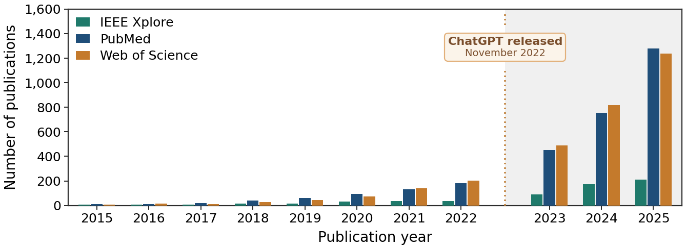

# Publication Trends in AI and Medical Education (2015-2025)

Reproducible publication-count figure from PubMed, IEEE Xplore, and Web of Science records for a survey on AI-supported medical education.


The chart is also saved as [figures/publication_growth_2015_2025.pdf](figures/publication_growth_2015_2025.pdf). A label between the 2022 and 2023 groups marks the public release of ChatGPT in November 2022. That marker is contextual. The chart does not establish that ChatGPT caused the publication increase.

## What this repository contains

- The annual publication counts used for the figure, for 2015-2025.
- A Python script that reads those counts and writes one PDF.

The original database exports are not included. The searches below are the collection process used to obtain the counts.

## Files

```text
.
├── README.md
├── requirements.txt
├── data/
│   └── annual_counts_2015_2025.csv
├── figures/
│   └── publication_growth_2015_2025.pdf
└── scripts/
    └── plot_publications.py
```

## Annual counts

| Year | PubMed | IEEE Xplore | Web of Science |
|---:|---:|---:|---:|
| 2015 | 11 | 7 | 9 |
| 2016 | 13 | 5 | 15 |
| 2017 | 19 | 8 | 12 |
| 2018 | 42 | 14 | 28 |
| 2019 | 62 | 16 | 45 |
| 2020 | 95 | 32 | 73 |
| 2021 | 130 | 38 | 141 |
| 2022 | 183 | 38 | 203 |
| 2023 | 453 | 92 | 490 |
| 2024 | 757 | 174 | 816 |
| 2025 | 1,279 | 211 | 1,236 |

The machine-readable dataset is [`data/annual_counts_2015_2025.csv`](data/annual_counts_2015_2025.csv).

These are database-specific records, not a deduplicated set of unique publications. A paper may occur in more than one database. Do not add the columns to obtain a combined literature total. The PubMed timeline may count both electronic and print years of a record. IEEE uses the exported Publication Year field. Web of Science may handle early-access years differently. The three sources are not interchangeable, and their counts need not match.

## Reproduce the figure

Requires Python 3.10 or newer. No database subscription is needed to redraw the saved figure.

```bash
python -m venv .venv
source .venv/bin/activate
python -m pip install -r requirements.txt
python scripts/plot_publications.py
```

On Windows PowerShell, activate the environment with `.venv\Scripts\Activate.ps1`.

The script reads the 11 rows of `data/annual_counts_2015_2025.csv` and writes `figures/publication_growth_2015_2025.pdf`.

## How the counts were collected

Record the full query, the search date, and any filters when a search is rerun. Fresh searches can return different counts after the databases update their records.

### 1. PubMed

Search at <https://pubmed.ncbi.nlm.nih.gov/advanced/>. The query preserved from the PubMed timeline export is:

```text
(
  "medical education"[tiab] OR
  "medical students"[tiab] OR
  "medical student"[tiab] OR
  "medical training"[tiab] OR
  "medical residency"[tiab] OR
  "residency training"[tiab] OR
  "undergraduate medical education"[tiab] OR
  "graduate medical education"[tiab] OR
  "continuing medical education"[tiab]
)
AND
(
  "artificial intelligence"[tiab] OR
  "machine learning"[tiab] OR
  "deep learning"[tiab] OR
  "generative AI"[tiab] OR
  "large language model"[tiab] OR
  "large language models"[tiab] OR
  "ChatGPT"[tiab] OR
  "intelligent tutoring system"[tiab] OR
  "intelligent tutoring systems"[tiab]
)
AND 2015:2025[dp]
```

1. Run the query and inspect the translated search details for errors.
2. On the results page, use the Results by Year timeline download to save the annual-count CSV.
3. Preserve the complete search query and the search date.
4. Keep the 2015-2025 rows for the figure. The timeline export also included 2014 and 2026 rows, and those rows were excluded.

PubMed documentation: <https://pubmed.ncbi.nlm.nih.gov/help/>.

### 2. IEEE Xplore

Search at <https://ieeexplore.ieee.org/> under Advanced Search. Use two All Metadata rows joined with AND.

Row 1 (medical education):

```text
"medical education" OR "medical students" OR "medical student" OR
"medical training" OR "medical residency" OR "residency training" OR
"undergraduate medical education" OR "graduate medical education" OR
"continuing medical education"
```

Row 2 (AI):

```text
"artificial intelligence" OR "machine learning" OR "deep learning" OR
"generative AI" OR "large language model" OR "large language models" OR
"ChatGPT" OR "intelligent tutoring system" OR "intelligent tutoring systems"
```

1. Select Publication Year 2015-2025, not Date Added to Xplore.
2. Record any content-type restrictions.
3. Export the matching records as CSV, including the Publication Year column.
4. Count rows by Publication Year.

The IEEE export used for these counts contained individual records, including some 2026 records. The figure uses 2015-2025 only. The export did not store the original search query, filters, or run date, so a later search may not return an identical set until those settings are recovered.

IEEE Xplore field documentation: <https://developer.ieee.org/docs/read/Metadata_API_responses>.

### 3. Web of Science Core Collection

Search at <https://www.webofscience.com/>. In Advanced Search, use this Topic query:

```text
TS=("medical education" OR "medical students" OR "medical student" OR
    "medical training" OR "medical residency" OR "residency training" OR
    "undergraduate medical education" OR "graduate medical education" OR
    "continuing medical education")
AND
TS=("artificial intelligence" OR "machine learning" OR "deep learning" OR
    "generative AI" OR "large language model" OR "large language models" OR
    "ChatGPT" OR "intelligent tutoring system" OR
    "intelligent tutoring systems")
```

1. Select Web of Science Core Collection and record which citation indexes are included.
2. Restrict years to 2015-2025 and record any document-type filters.
3. Open Analyze Results, then Publication Years.
4. Export the Publication Years and Count columns.
5. Compare the annual counts with the table above.

The Web of Science export used here was a year-and-count table. It did not store the original query, search date, index selection, or filters. The query above is the topic search used for this collection. It is not proof that a later Core Collection search used identical index settings.

Web of Science guidance: <https://webofscience.help.clarivate.com/en-us/Content/analyze-results.html>.

## Interpretation

- The counts show indexed records matching these database queries. They are not the number of studies included in a systematic review, and they do not measure educational effectiveness.
- PubMed, IEEE Xplore, and Web of Science overlap. Do not add their counts.
- The queries have the same intent, but the fields differ. PubMed uses `[tiab]`, IEEE uses All Metadata, and Web of Science Topic search includes keyword fields.
- The rise from 2022 to 2023 coincides with the public release of ChatGPT in November 2022. The figure does not show that the release caused the rise.
- Database coverage and year assignment can change. A search run on a later date can return different numbers.
